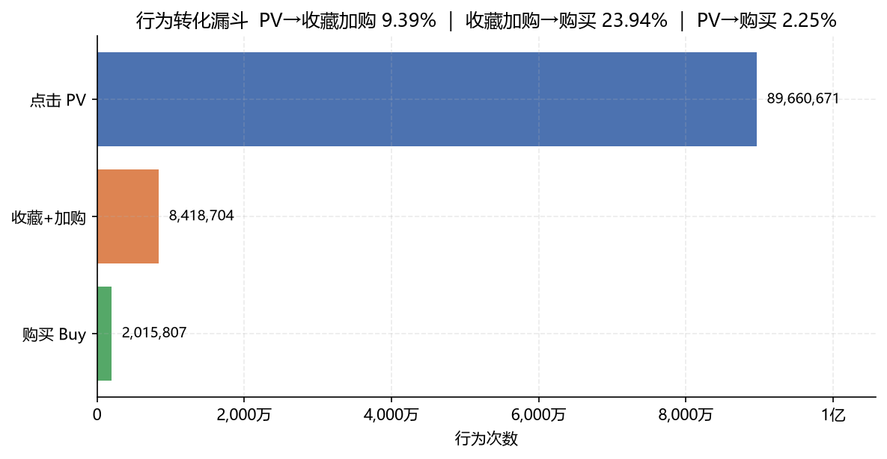
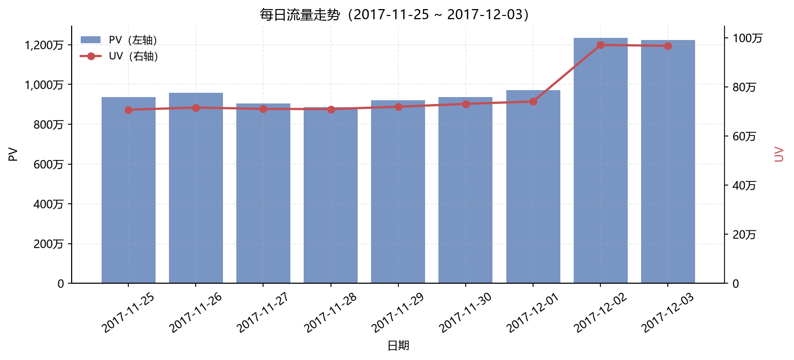
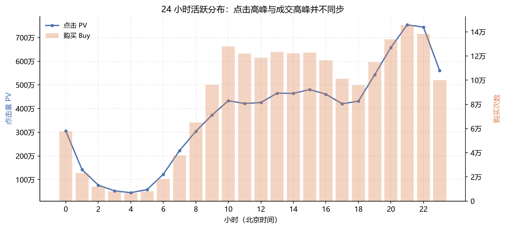
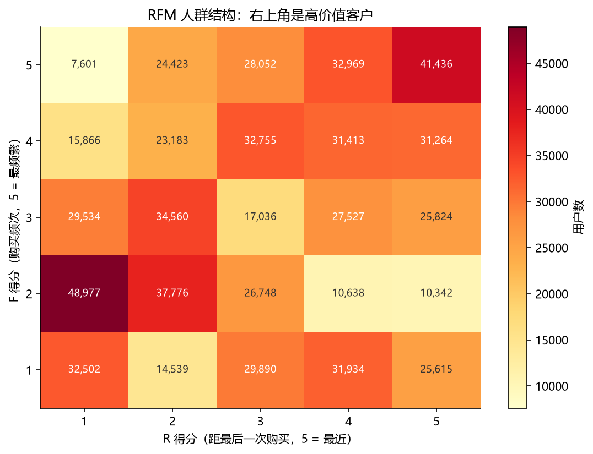
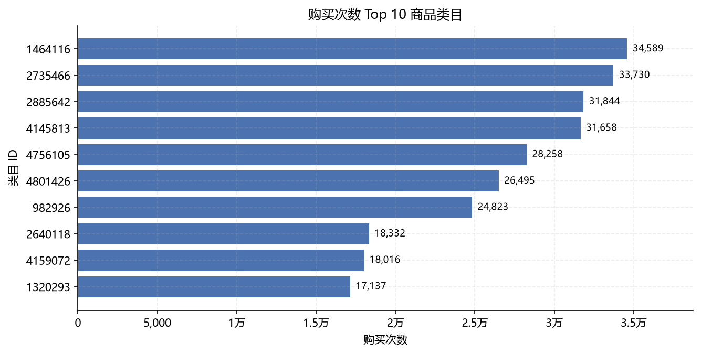

# 淘宝用户行为数据分析（1 亿条）

对阿里天池 **UserBehavior** 数据集（100,150,807 行、3.6 GB）的一次完整分析：
数据清洗 → PV/UV 与流量走势 → 行为转化漏斗 → 活跃时段 → RFM 用户分层 → 商品与类目维度。

用 **DuckDB** 在单机 Windows 笔记本上跑完全量数据：建表清洗 **15.2 秒**，
14 项分析 **5.5 秒**，不再需要 Hadoop / Hive 集群。

> 本仓库是在一份单文件脚本（`legacy/run_analysis_v1.py`）的基础上重构的：
> 修掉了会导致结果出错的逻辑问题，把全流程从「4 次全表重写」压到「1 次扫描」，
> 并补上可复现的工程骨架（SQL 外置、CLI、测试、CI、图表）。
> 具体改了什么见 [优化说明](#优化说明)。

---

## 核心结论

数据覆盖 **2017-11-25 ~ 2017-12-03** 共 9 天（双 12 预热期），清洗后 **100,095,182** 条行为、
**987,991** 位用户。

| 指标 | 数值 |
| --- | --- |
| 总点击 PV | 89,660,671（占全部行为 89.58%） |
| 独立用户 UV | 987,991 |
| 加购 cart | 5,530,446（5.53%） |
| 收藏 fav | 2,888,258（2.89%） |
| 购买 buy | 2,015,807（2.01%） |
| 人均 PV | 90.8 次 |
| 复购率 | **66.01%**（443,858 / 672,404 位购买用户） |

### 1. 转化漏斗：100 次点击只换来 2.25 次购买



PV → 收藏+加购 只有 **9.39%**，但收藏加购 → 购买高达 **23.94%**。
说明**瓶颈在「让用户产生兴趣」这一步**，而不在最后的成交环节：
已经收藏/加购的用户有近 1/4 会下单，因此提升曝光到互动（推荐、详情页、评价）
的转化，比在购物车里做催付更有杠杆。

### 2. 周末流量断崖式抬升，增量几乎全部来自「新访客」



12-02（周六）相比前一个工作日 12-01（周五）：

| | 12-01 周五 | 12-02 周六 | 变化 |
| --- | --- | --- | --- |
| PV | 9,718,956 | 12,329,641 | **+26.9%** |
| UV | 740,139 | 970,401 | **+31.1%** |
| 人均 PV | 13.13 | 12.71 | **−3.2%** |

UV 的涨幅大于 PV，人均 PV 反而下降 —— 增量是被大促拉进来的
**低频新访客**，而不是老用户变活跃。这两天要盯的是新客首单转化，
而不是老客复购。

### 3. 活跃时段：0 点有一个反常的第二高峰



全天最高峰在 **21 点（753.8 万 PV）**，22 点（744.3 万）紧随其后，晚间 19–23 点
是最集中的成交时段。值得注意的是 **0 点仍有 305.7 万 PV，比早上 8 点（304.2 万）还高**
—— 凌晨零点是一个独立的小高峰（熬夜浏览 + 零点秒杀/领券），
随后 1 点跌到 142 万、4 点见底 45 万。运营侧的零点活动时段设置与此吻合。

### 4. RFM 分层：6.16% 的用户贡献了最优质的复购群体



按用户数五等分后，**R=5 & F=5（最近买过、且买得最频繁）共 41,436 人，占 6.16%**，
平均购买 8.05 次，是核心高价值人群。

更值得动作的是 **R ≤ 2 且 F ≥ 4 的「沉睡高价值」用户：71,073 人（10.57%）**——
他们买得多、忠诚度不低，但最近 2 档内没再下单，是唤醒成本最低、回报最高的一批。

> 原始脚本用 `dense_rank` 再 `ntile` 的口径，因为 R 只有 1~8 个取值会严重扎堆，
> Top 榜单里 20 个人全是 10 分、毫无区分度。这里改用按**用户数**分层。

### 5. 商品维度：爆款高度集中，且转化率差异极大



- 类目 `1464116` 以 34,589 次购买居首，PV 只有 68 万（转化率 5.06%）；
  而 `4756105` PV 高达 448 万却只有 28,258 次购买（0.63%）——
  **前者是精准类目，后者是「看了不买」的流量黑洞**。
- 单品 `3122135` 只有 1,779 次曝光，却成交 1,408 次（**79.2%**），
  是典型的强需求型商品（复购/直接下单）。

---

## 快速开始

### 1. 拿数据

从[阿里天池 UserBehavior](https://tianchi.aliyun.com/dataset/dataDetail?dataId=649)
下载 `UserBehavior.csv`（约 3.6 GB，无表头），放到 `data/UserBehavior.csv`。
仓库不包含数据文件（见 [.gitignore](.gitignore)）。

### 2. 装依赖

```bash
python -m venv .venv
.venv\Scripts\activate          # Windows
# source .venv/bin/activate     # macOS / Linux
pip install -r requirements.txt
```

### 3. 跑

```bash
# 全流程：建表清洗 → 14 项分析 → 出图
python run.py all

# 或分步
python run.py build     # CSV → data/taobao.duckdb，一次扫描完成清洗
python run.py analyse   # → results/*.csv + results/SUMMARY.md
python run.py charts    # → results/figures/*.png
python run.py info      # 看库里的表和行数
```

常用参数：

```bash
python run.py build --csv /path/to/UserBehavior.csv --db data/taobao.duckdb --force
python run.py analyse --threads 8 --memory 6GB
```

> 也可以用标准入口 `taobao-analysis <命令>`（`pip install -e .` 之后）。
> **如果仓库路径含中文**，Windows 下 `pip install -e .` 生成的 `.pth` 会被
> `site` 模块按本地编码读取而报 `UnicodeDecodeError`，
> 请改用 `python run.py`，或把仓库放到纯 ASCII 路径下。

---

## 项目结构

```
.
├── run.py                     # 免安装入口（加入 src 到 sys.path）
├── sql/
│   ├── build.sql              # 建表 + 清洗：一次扫描
│   ├── prepare.sql            # 按用户聚合 user_count
│   ├── analysis/              # 14 个分析查询，每个文件自带 @name/@title/@desc
│   └── hive/                  # 原始 Hive 版脚本（参考）
├── src/taobao_analysis/
│   ├── db.py                  # 连接、建表清洗、路径探测
│   ├── analysis.py            # 读取 SQL、执行、导出 CSV / SUMMARY.md
│   ├── charts.py              # 由结果 CSV 生成 PNG
│   └── cli.py                 # build / analyse / charts / info / all
├── tests/                     # 30 个测试：清洗等价性 + 每条 SQL 的口径
├── results/                   # 提交到仓库的分析结果（CSV、SUMMARY.md、图）
├── legacy/                    # 优化前的原脚本，仅作对照
└── .github/workflows/ci.yml   # Python 3.10/3.11/3.12 跑 pytest
```

分析 SQL 全部外置到 `sql/analysis/*.sql`，用 `-- @name/@title/@desc` 标注元信息，
新增一项分析只需丢一个 `.sql` 文件进去，不需要改 Python。

---

## 优化说明

### 性能与体积

| 维度 | 优化前 | 优化后 |
| --- | --- | --- |
| 建表清洗 | **4 次全表重写**（建表 → 全列 GROUP BY 去重 → 重写 datetime → 按日期过滤） | **1 次扫描**：读取时按时间戳整数区间过滤 → 去重 → 转时间类型 → 落表 |
| 实测耗时 | 每次重写都要把 1 亿行重新落盘 | **15.2 秒**建表（1 亿行）+ 1.2 秒生成 user_count |
| 库文件体积 | 7.04 GiB | **1.39 GiB（−80%）** |
| 时间字段 | `VARCHAR` 存 19 字节字符串 | 原生 `TIMESTAMP`，查询无需 `CAST` |
| 去重口径 | `GROUP BY` 6 列（含派生列） | `DISTINCT` 5 列（派生列不算作去重依据） |
| 分析耗时 | 每条查询现算 | `user_count` 物化复用，14 项查询 **5.5 秒** |

### 正确性

| 问题 | 后果 | 修正 |
| --- | --- | --- |
| `[11]` `[12]` 榜单只有 `LIMIT 10`、没有 `ORDER BY` | **返回的是任意 10 行**，不是 Top 10 | 合并为 `sql/analysis/10_rfm.sql`，带完整排序 |
| 基准日 `DATE '2017-12-04'` 写死 | 换数据集即算错 | 由数据推导：`max(event_time)` 的次日 |
| `to_timestamp()` 依赖运行机器时区 | 在 UTC 机器上日期边界与小时分布整体偏 8 小时 | 显式 `AT TIME ZONE 'Asia/Shanghai'` |
| 星期几用 `pmod(datediff(...,'1920-01-01') - 3, 7)` | 正确性靠纪元星期数，难以复核 | 改用 `dayofweek()` 显式换算 |
| 购买率榜不设浏览下限 | pv=1、buy=262 的账号以 262 的「购买率」霸榜 | 加 `pv >= 10`，并在下文说明该指标的固有缺陷 |

### 工程

- **硬编码路径** `D:\...` → CLI 参数 + 自动探测（`--csv` / `--db`）。
- **结果只 print** → 落 `results/*.csv`、`results/SUMMARY.md`、`results/figures/*.png`。
- **零测试** → 30 个测试覆盖「清洗后行数与口径」「每条 SQL 都能跑通且指标自洽」。
- **无 CI** → GitHub Actions 在 Python 3.10/3.11/3.12 上跑 pytest。
- **无 `.gitignore`** → 3.6 GB CSV 与 7.5 GB `.db` 紧挨代码，现在都已排除。

---

## 指标口径与已知局限

1. **漏斗是「行为级」不是「用户级」**：收藏次数 + 加购次数相加，
   同一用户两种行为都做会重复计数。因此 `收藏加购 → 购买` 可能大于 100%。
2. **`buy / pv` 不是真实购买转化率**：每条记录是一次独立行为，购买事件不要求
   先有对应点击。所以该比值可以大于 1（清洗后仍能找到 pv=17、buy=55 的用户）。
   它适合做「相对排序」，不适合当绝对转化率解读。
3. **没有金额字段**：RFM 的 M（Money）无法计算，只用 R + F 打分。
4. **只有 9 天**：R 的取值只有 1~8，任何基于 R 的分档都偏粗；
   `10_rfm.sql` 保留了教程口径（`dense_rank` + `ntile`）便于对照，
   `14_rfm_segments.sql` 给出按用户数分层的改良版。
5. **11-25、11-26 是残缺周末**：一周活跃分布只取 11-27 ~ 12-03 这个完整自然周。

---

## 测试

```bash
pip install -r requirements.txt pytest
python -m pytest -q
```

测试不需要原始数据：`tests/conftest.py` 会造一份几十行的合成数据
（覆盖四种行为、完整自然周、0~23 点），让每条分析 SQL 都被真实执行一遍，
再断言漏斗合计、复购率、RFM 分数区间、星期映射等口径。

CI 配置见 [.github/workflows/ci.yml](.github/workflows/ci.yml)。

---

## 数据来源与许可

- 数据：[阿里天池 · UserBehavior](https://tianchi.aliyun.com/dataset/dataDetail?dataId=649)（遵循其原始许可，本仓库不转售、不再分发数据文件）。
- 代码：[MIT](LICENSE)。
